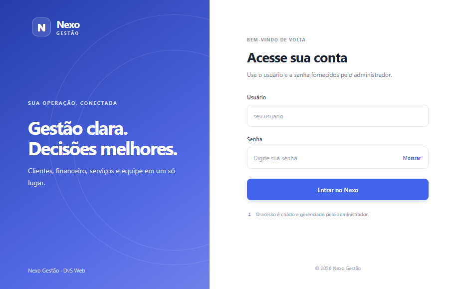

<div align="center">
  

  <h1>Nexo Gestão</h1>
  <p>Clientes, serviços, financeiro e equipe em um só lugar.</p>

  <p>
    <a href="https://deivsoares.github.io/nexoapp/">Abrir o Nexo</a>
    ·
    <a href="./FIREBASE.md">Configurar o Firebase</a>
  </p>

  <p>
    
    
    
    <a href="https://github.com/DeivSoares/nexoapp/actions/workflows/deploy.yml">
      
    </a>
  </p>
</div>

<br>

<p align="center">
  
</p>

## Sobre o projeto

O **Nexo Gestão** é um painel web para organizar a operação de pequenas empresas e equipes. A aplicação é feita com React e Vite, usa Firebase Authentication para login e Cloud Firestore para armazenar e sincronizar os dados.

Cada empresa tem seus próprios dados. As contas ativas vinculadas ao mesmo `companyId` compartilham clientes, serviços, financeiro e equipe; empresas diferentes permanecem isoladas.

## O que você encontra

- **Visão geral:** indicadores da operação, atividade recente, clientes recentes e renovações dos próximos 10 dias.
- **Clientes:** cadastro e edição de clientes, contato por WhatsApp, imagem por URL, serviço associado, valores, vencimento e status.
- **Renovações:** clientes com mensalidade passam para pendente dois dias antes do vencimento; a confirmação registra o recebimento e atualiza a próxima renovação.
- **Serviços:** catálogo compartilhado da empresa para sites, bots e outros serviços, com mensalidade, valor fixo/de entrada e status.
- **Financeiro:** receitas, despesas e lançamentos pendentes, com integração das mensalidades dos clientes.
- **Equipe:** contas vinculadas à empresa com privilégios de administrador ou membro.
- **Tema claro e escuro:** alternância na barra superior, com preferência salva no navegador.
- **Perfil:** nome, privilégio e imagem configurável por URL.
- **Busca:** pesquisa nos registros da área aberta.

## Tecnologias

- React 19
- Vite 6
- Firebase Authentication
- Cloud Firestore
- CSS responsivo
- Node.js e `node:test` para os testes

## Começar

### Requisitos

- Node.js 22 ou superior
- npm
- Um projeto Firebase com Authentication e Cloud Firestore configurados

### 1. Obter o código e instalar dependências

```bash
git clone https://github.com/DeivSoares/nexoapp.git
cd nexoapp
npm ci
```

### 2. Configurar o Firebase

Crie o arquivo `.env.local` a partir do modelo:

**PowerShell**

```powershell
Copy-Item .env.example .env.local
```

**macOS / Linux**

```bash
cp .env.example .env.local
```

Preencha as variáveis com os dados do app Web em **Firebase Console → Configurações do projeto → Seus apps**:

```dotenv
VITE_FIREBASE_API_KEY=
VITE_FIREBASE_AUTH_DOMAIN=
VITE_FIREBASE_PROJECT_ID=
VITE_FIREBASE_STORAGE_BUCKET=
VITE_FIREBASE_MESSAGING_SENDER_ID=
VITE_FIREBASE_APP_ID=
```

Habilite o método **E-mail/senha** em Authentication, crie o banco Firestore e publique as regras de [`firestore.rules`](./firestore.rules). Para preparar a primeira conta administradora, consulte o [guia completo de configuração do Firebase](./FIREBASE.md).

> As variáveis `VITE_FIREBASE_*` são a configuração pública do app Web e ficam visíveis no bundle do navegador. **Nunca** coloque senhas, chaves de service account ou credenciais administrativas nelas. A proteção dos dados deve ser feita pelas regras do Firestore.

### 3. Rodar localmente

```bash
npm run dev
```

Abra o endereço informado pelo Vite, normalmente <http://127.0.0.1:5173/login.html>. Depois de alterar `.env.local`, reinicie o servidor.

### Comandos úteis

| Comando | Descrição |
| --- | --- |
| `npm run dev` | Inicia o servidor local de desenvolvimento |
| `npm run build` | Gera a versão de produção em `dist/` |
| `npm run check` | Executa a verificação de build |
| `node --test src/*.test.js` | Executa os testes automatizados |

## Dados e acesso

- Os vínculos de usuário ficam em `companyMemberships/{UID}`.
- Os dados compartilhados da empresa ficam em `companies/{companyId}/data/main`.
- O catálogo compartilhado de serviços fica em `companies/{companyId}/services/{serviceId}`.
- As regras do Firestore verificam autenticação, vínculo ativo e empresa correspondente.
- `canManageUsers` autoriza o gerenciamento de contas da equipe. As funções ainda não restringem o acesso às outras telas do app.
- As renovações e os registros financeiros relacionados são mantidos pelo app; os dados não devem ser protegidos com regras abertas.

Para detalhes sobre criação de usuários, migração dos dados e solução de problemas de permissões, consulte [`FIREBASE.md`](./FIREBASE.md).

## Publicar no GitHub Pages

O repositório inclui um workflow em [`.github/workflows/deploy.yml`](./.github/workflows/deploy.yml) que compila o projeto e publica `dist/`.

1. Em **Settings → Pages**, escolha **GitHub Actions** como fonte de publicação.
2. Em **Settings → Secrets and variables → Actions → Variables**, configure as variáveis `VITE_FIREBASE_API_KEY`, `VITE_FIREBASE_AUTH_DOMAIN`, `VITE_FIREBASE_PROJECT_ID`, `VITE_FIREBASE_STORAGE_BUCKET`, `VITE_FIREBASE_MESSAGING_SENDER_ID` e `VITE_FIREBASE_APP_ID`.
3. Adicione `deivsoares.github.io` aos domínios autorizados em **Firebase Authentication → Settings → Authorized domains**.
4. Envie alterações para `main` ou inicie o workflow manualmente na aba **Actions**.

O site publicado fica em <https://deivsoares.github.io/nexoapp/>.

## Estrutura do projeto

```text
.
├── .env.example                  # Modelo da configuração local do Firebase
├── .github/workflows/deploy.yml  # Build e publicação no GitHub Pages
├── docs/images/                  # Capturas de tela usadas na documentação
├── src/
│   ├── assets/                   # Logo e ícone do Nexo
│   ├── App.jsx                   # Painel e telas de gestão
│   ├── Login.jsx                 # Tela de acesso
│   ├── cloudData.js              # Persistência e sincronização no Firestore
│   ├── data.js                   # Regras e transformações dos dados
│   └── *.test.js                 # Testes automatizados
├── firestore.rules               # Regras de segurança do Firestore
├── FIREBASE.md                   # Guia detalhado de configuração
└── vite.config.js                # Configuração do Vite e do GitHub Pages
```

---

<p align="center">
  Desenvolvido por <a href="https://github.com/DeivSoares">DvS Web</a>
</p>
